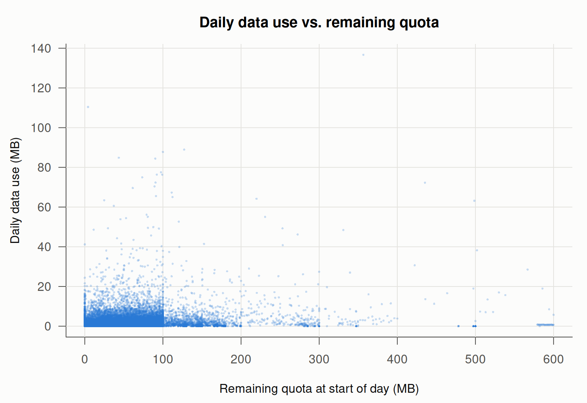

# Homework 2 – Part 2: Censored Models

Data: `Mobile_data_usage.csv`. It has 31,000 rows: 1,000 customers observed on each of the 31 days of their billing cycle.
Code: [`homework2_part2.R`](homework2_part2.R). Full R output: [`homework2_part2_output.txt`](homework2_part2_output.txt).

| Variable | Min | Median | Mean | Max |
|---|---|---|---|---|
| DataUse (MB/day) | 0 | 0.53 | 1.67 | 136.68 |
| Quota (MB left) | 0 | 59.76 | 62.65 | 600 |
| Days (days left) | 1 | 16 | 16 | 31 |

---

## Task 1: Scatter plot

```r
usage <- read.csv("Mobile_data_usage.csv")
plot(usage$Quota, usage$DataUse,
     xlab = "Remaining quota at start of day (MB)",
     ylab = "Daily data use (MB)",
     main = "Daily data use vs. remaining quota",
     pch = 16, cex = 0.4, col = rgb(0.16, 0.47, 0.84, 0.25))
```



**Which pattern needs special treatment?** A large pile of observations sits exactly on the horizontal line **DataUse = 0**, and no observation is below it.

- **6,536 of the 31,000 customer-days (21.1%) have zero data use.**
- Usage cannot be negative, so the dependent variable is **censored from below at 0**. This is a corner solution: on many days the customer's "desired" usage is zero or less, and all we observe is 0.

Ordinary least squares treats those zeros as ordinary points on a straight line. Its errors cannot be normal or have constant variance around a line that has a floor at zero, and the slope estimates are biased, usually toward zero. A censored-regression (**Tobit**) model is needed.

The plot also shows a strongly right-skewed outcome: most days use a few MB, and a few days use more than 50 MB.

---

## Task 2: Linear model

```r
ols <- lm(DataUse ~ Quota + Days, data = usage)
summary(ols)
```

```
Coefficients:
              Estimate Std. Error t value Pr(>|t|)
(Intercept)  1.3633019  0.0476447  28.614  < 2e-16 ***
Quota        0.0079765  0.0004577  17.426  < 2e-16 ***
Days        -0.0123239  0.0025276  -4.876 1.09e-06 ***

Residual standard error: 3.817 on 30997 degrees of freedom
Multiple R-squared:  0.009702,  Adjusted R-squared:  0.009638
F-statistic: 151.8 on 2 and 30997 DF,  p-value: < 2.2e-16
```

---

## Task 3: Tobit model

```r
library(censReg)
tobit <- censReg(DataUse ~ Quota + Days, left = 0, right = Inf, data = usage)
summary(tobit)
```

```
Call:
censReg(formula = DataUse ~ Quota + Days, left = 0, right = Inf,
    data = usage)

Observations:
         Total  Left-censored     Uncensored Right-censored
         31000           6536          24464              0

Coefficients:
              Estimate Std. error t value  Pr(> t)
(Intercept)  0.6111869  0.0576965  10.593  < 2e-16 ***
Quota        0.0090140  0.0005516  16.340  < 2e-16 ***
Days        -0.0119462  0.0030650  -3.898 9.71e-05 ***
logSigma     1.4947160  0.0046189 323.611  < 2e-16 ***
---
Signif. codes:  0 '***' 0.001 '**' 0.01 '*' 0.05 '.' 0.1 ' ' 1

Newton-Raphson maximisation, 7 iterations
Return code 8: successive function values within relative tolerance limit (reltol)
Log-likelihood: -76375.86 on 4 Df
```

`logSigma` is the log of the error standard deviation, so σ̂ = e^1.49472 = **4.458**.

---

## Task 4: Linear and Tobit estimates side by side

```r
data.frame(Linear = coef(ols), Tobit = coef(tobit)[1:3])
```

| | Linear (OLS) | Tobit | Tobit / Linear |
|---|---|---|---|
| (Intercept) | 1.363302 | 0.611187 | 0.448 |
| Quota | **0.007977** | **0.009014** | **1.130** |
| Days | −0.012324 | −0.011946 | 0.969 |

**The Tobit coefficient for Quota is greater than the linear one: 0.00901 vs. 0.00798, about 13% larger.**

**Why is it greater?**

1. **The two coefficients measure different things.** The Tobit β measures the effect of Quota on the **latent (desired) usage** DataUse\*. This variable has no floor at zero, so the Tobit β is the full slope of a relationship that is not truncated. The OLS coefficient is fitted to the **observed** usage, which is stuck at 0 on 21% of days.
2. **OLS flattens the slope.** OLS treats every zero as a genuine value on the regression line. For a censored observation, the desired usage is really ≤ 0, but OLS records it as exactly 0. Replacing the latent values with 0 compresses the variation in y that goes with changes in x, which pulls the fitted line toward a flat line. This is the usual **attenuation bias** of OLS on censored data. The Tobit likelihood corrects it by modelling the zeros through P(DataUse\* ≤ 0) = 1 − Φ(xβ/σ) instead of as points on the line.

The **intercept** follows the same logic. OLS (1.36) has to stay above the zeros, while the Tobit latent intercept (0.61) is free to be lower. **Days** is almost the same in both models, and the negative sign is the same: with more days left in the cycle, customers use slightly less per day; as the end of the cycle approaches, they use more.

---

## Task 5: Marginal effects of Quota (Tobit vs. linear)

```r
mean_days <- mean(usage$Days)                                  # 16
margEff(tobit, xValues = c(1, 10,   mean_days))                # (i)
margEff(tobit, xValues = c(1, 2000, mean_days))                # (ii)
```

```
(i) Quota = 10, Days = mean
       Marg. Eff.  Std. Error t value  Pr(>|t|)
Quota  0.00491762  0.00027835 17.6672 < 2.2e-16 ***
Days  -0.00651732  0.00166369 -3.9174  8.97e-05 ***

(ii) Quota = 2000, Days = mean
       Marg. Eff.  Std. Error t value  Pr(>|t|)
Quota  0.00901381  0.00055179 16.3356 < 2.2e-16 ***
Days  -0.01194598  0.00306501 -3.8975 9.738e-05 ***
```

**How it is computed.** In a Tobit model, the marginal effect of x_j on the expected **observed** usage is

∂E[DataUse | x] / ∂x_j = β_j · Φ(xβ / σ)

where Φ(xβ/σ) is the probability that usage is positive (not censored). By hand, with σ̂ = 4.4581:

| | Quota = 10 | Quota = 2,000 |
|---|---|---|
| xβ = 0.61119 + 0.009014·Quota − 0.011946·16 | 0.5102 | 18.4480 |
| xβ / σ | 0.1144 | 4.1381 |
| Φ(xβ / σ) = P(DataUse > 0) | 0.5456 | 0.99998 |
| ME of Quota = 0.009014 × Φ | **0.004918** | **0.009014** |

These match the `margEff()` output exactly.

| Model | ME of Quota | ME of Days |
|---|---|---|
| Linear (the same for every customer) | 0.007977 | −0.012324 |
| Tobit, Quota = 10, Days = 16 | 0.004918 | −0.006517 |
| Tobit, Quota = 2,000, Days = 16 | 0.009014 | −0.011946 |

**What the values mean**

- **(i) Quota = 10, 16 days left.** One more MB of remaining quota raises expected daily usage by **0.0049 MB**. Scaled up, 100 MB more quota means about **0.49 MB/day** more usage. At this point the model gives only a **55%** chance that the customer uses any data that day.
- **(ii) Quota = 2,000, 16 days left.** One more MB of quota raises expected daily usage by **0.0090 MB**, or about **0.90 MB/day per 100 MB**. The chance of positive usage is essentially 1, so the marginal effect equals the Tobit coefficient β_Quota.
- **Linear model.** It says the effect is **0.0080 MB** for every customer, whatever their situation.

**How and why the marginal effects vary.** The Tobit marginal effect is β scaled by Φ(xβ/σ), the probability of being in the uncensored region.

- When Quota is **low**, xβ is close to the censoring point 0. Many such customer-days end with zero usage, so an extra MB of quota only moves usage for the fraction who actually use data. The effect shrinks to β·Φ ≈ 0.55β.
- As Quota **rises**, xβ grows, Φ → 1, and the marginal effect rises toward the full β. At Quota = 2,000 there is essentially no chance of zero usage, so the censored and latent models agree.
- The effect of Days changes in the same way. More days left lowers xβ and Φ, which shrinks both marginal effects.

So E[DataUse | x] is a convex, non-linear function of Quota. It is flat near the zero floor and approaches a line with slope β when quota is plentiful.

**Conclusions and implications**

1. **Usage depends on remaining quota.** Customers with more quota left use more data per day, and fewer days left (holding quota fixed) also means more use per day. Customers pace their consumption across the billing cycle rather than using a fixed amount each day.
2. **The linear model misstates the effect for everyone.** Its single number (0.0080) **overstates** the response of low-quota customers (0.0049, about 62% more than the true effect) and **understates** the response of high-quota customers (0.0090). Because it ignores the pile of zeros, it cannot show that the effect depends on how close a customer is to running out.
3. **Business implication for the carrier.** Extra quota (bonus data, top-ups, larger plans) raises usage much less for customers who are nearly out of quota, many of whom are not using data at all on a given day, than for customers with a comfortable balance. Promotions or pricing that aim to stimulate usage should be targeted according to where the customer is in the quota/day space. The Tobit marginal effects give that targeting information; a single OLS coefficient does not.
4. **Caveat.** Quota = 2,000 MB is far outside the observed range (the maximum in the data is 600 MB). Point (ii) is an extrapolation. It is useful for showing that the marginal effect approaches β, but it is not a prediction for a real customer in this sample.
